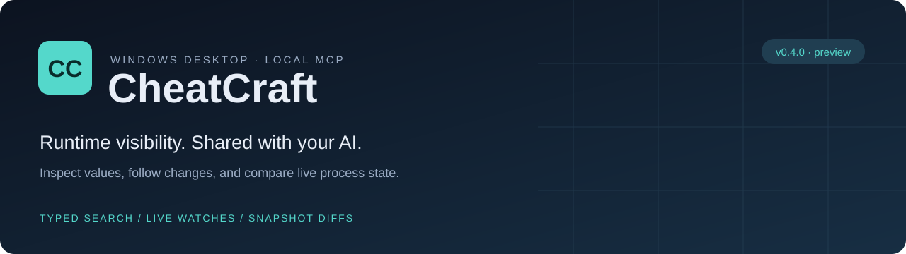
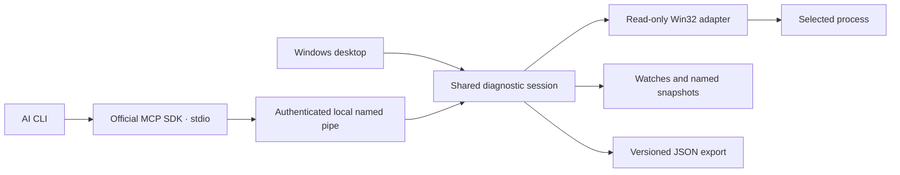

<p align="center">
  
</p>

<p align="center">
  <a href="https://github.com/arpanjot-coding/CheatCraft/releases/tag/v0.4.0"></a>
  
  
  <a href="LICENSE"></a>
</p>

<p align="center">
  <strong>A Windows desktop workspace for typed memory searches, live watches and snapshot comparisons—with an MCP interface for your preferred AI client.</strong>
</p>

<p align="center">
  <a href="https://arpanjot-coding.github.io/CheatCraft/">Product website</a> ·
  <a href="https://github.com/arpanjot-coding/CheatCraft/releases">Download</a> ·
  <a href="#quick-start">Quick start</a> ·
  <a href="#connect-your-ai-client">Connect your AI</a> ·
  <a href="CHANGELOG.md">Changelog</a> ·
  <a href="CONTRIBUTING.md">Contribute</a>
</p>

---

## What is CheatCraft?

CheatCraft brings process inspection and AI-assisted diagnosis into one local session. Select a process in the desktop, search for a typed value, narrow the candidates as the value changes, and turn useful addresses into watches. Capture a named baseline and compare it with live values. A compatible MCP client can work with the same candidates, watches and snapshots.

The application reads actual process memory through documented Windows APIs. It is intended for your own development builds and other processes you are authorized to inspect. The current release is **v0.4.0 preview**: a working diagnostic tool with explicit limits, not a complete replacement for every feature in established memory debuggers.

## Contents

- [Features](#features)
- [Quick start](#quick-start)
- [Search and refinement](#search-and-refinement)
- [Watches and snapshots](#watches-and-snapshots)
- [Connect your AI client](#connect-your-ai-client)
- [Architecture](#architecture)
- [Local trust and permissions](#local-trust-and-permissions)
- [Troubleshooting](#troubleshooting)
- [Build and verify](#build-and-verify)
- [Known limits and roadmap](#known-limits-and-roadmap)
- [Licence and acknowledgements](#licence-and-acknowledgements)

## Features

### A focused desktop workspace

- Five workspaces: **Memory search**, **Live watches**, **Snapshots**, **AI connection** and **Session activity**.
- A consistent dark interface with readable typography, explicit empty states and inline errors.
- Process filtering by executable name or PID, plus explicit attach and detach controls.
- A two-column scan layout on wider windows and a stacked, scrollable layout on smaller windows.
- Windows display scaling applied to fixed geometry as well as text.
- Sortable result tables, copy-address actions, preserved selection and watch-change highlighting.
- Background target reads, cooperative scan cancellation and asynchronous shutdown.

### Real runtime inspection

- Little-endian `int32`, `uint32`, `int64`, `float32` and `float64` searches.
- Exact-value searches aligned to the selected type's byte width.
- Refinement by **equal**, **changed**, **unchanged**, **increased** or **decreased**.
- Explicit scan coverage, bytes visited, unreadable bytes, duration and stop reason.
- Page-level read retries when a large read fails, so inaccessible pages do not hide readable neighbours.
- Up to 256 watched addresses and 50 named watch snapshots.
- Snapshot comparisons that distinguish changed values, unreadable memory, removed watches and changed types.
- Versioned JSON export of watches, snapshots, process metadata and recent actions.

### Your AI, connected locally

- The official MCP Python SDK handles stdio protocol communication.
- The AI adapter operates on the process selected in the desktop.
- Search, refinement, watches, snapshots, progress and cancellation share the desktop's session.
- A local authenticated Windows named pipe connects the adapter to the desktop; there is no HTTP listener.
- No automatic process attachment, arbitrary memory writing, driver installation or privilege escalation.

## Quick start

### Download the source preview

1. Download `CheatCraft-v0.4.0-source.zip` from [Releases](https://github.com/arpanjot-coding/CheatCraft/releases/tag/v0.4.0).
2. Extract the complete folder into a private, writable location.
3. Install 64-bit Python with Tcl/Tk, run `Setup.cmd`, then open `Launch.cmd`.
4. Filter the process list, select your development process and click **Attach**.
5. Enter the value and type, choose a useful address range if known, then run **New exact search**.

A matching SHA-256 digest is provided with the release.

### Experimental portable executable build

The repository includes a two-executable portable build recipe. The packaged MCP server passed initialization and an owned-process memory search, but Windows Application Control blocked the unsigned desktop executable on the development computer (WinError 4551). Desktop binary startup could not be verified, so **this release distributes source, not a validated desktop executable**. Use the Python launcher on this configuration. Do not disable system protections to run a preview.

When independently validated, a portable package contains `CheatCraft.exe`, `CheatCraft-MCP.exe` and their shared `_internal` folder. Its bundled runtime does not require a separate Python installation. The build remains unsigned.

### Run from source

Use Windows x64 with 64-bit Python 3.11 or newer and Tcl/Tk installed. The release was built and tested with Python 3.14.7; other Python versions are not yet covered by the local verification results.

```powershell
git clone https://github.com/arpanjot-coding/CheatCraft.git
cd CheatCraft
python -m venv .venv
.\.venv\Scripts\python -m pip install -r requirements-lock.txt
.\.venv\Scripts\python app.py
```

Alternatively, run `Setup.cmd`, then `Launch.cmd`. Dependencies are downloaded only during setup. The source launcher includes a compatibility resolver for zipped Tcl/Tk libraries in Windows Python 3.14 virtual environments.

## Search and refinement

### Start with a known value

Choose the type that matches your game's storage, enter the value and start an exact search. Results show the address, type and observed value. To inspect a result over time, select it and choose **Watch selected**.

Use a narrow allocation range when your development logs or engine instrumentation provide one. Range bounds accept decimal values or `0x` hexadecimal addresses. The end address is exclusive.

### Refine as state changes

- **Equal:** keep candidates matching the entered value.
- **Changed / unchanged:** compare the current bytes with the previous successful scan's observations.
- **Increased / decreased:** compare decoded numeric values with those observations.

Each successful refinement advances the comparison baseline for the retained candidates. The refinement button identifies the candidate set's type; changing the new-search type does not reinterpret existing candidates. Watch types have separate controls.

Floating-point exact searches compare their encoded bytes, not an epsilon. Search input must be finite and fit its selected type. Non-finite values encountered while reading memory are represented as strings in JSON exports and MCP responses, keeping the JSON valid.

### Understand scan limits

An initial search visits at most **256 MiB** and retains at most **10,000 candidates**. The desktop displays the first **1,000**. A scan stopped by its byte budget, candidate cap or unreadable pages is marked incomplete. This is not evidence that an address is absent from the unsearched area.

Click **Cancel scan** or press **Escape** to request cancellation. Previously committed candidates, type and baseline are preserved if cancellation is observed. Cancellation is cooperative between work units and cannot interrupt an in-flight Windows API call.

## Watches and snapshots

**Live watches** refresh in background work approximately every 600 ms when the session is available. Their addresses can become invalid when a target reallocates memory or restarts. Selecting a watch fills its address, label and type into the editor; adding the same address updates that watch. Integer sorting preserves precision above 2⁵³.

In **Snapshots**, enter a name and capture the current watched values. Reusing a name replaces that snapshot. Select a saved snapshot to compare it with live values or delete it. Reads across different addresses are sequential, not atomic.

Snapshots are **typed watch baselines**, not process dumps or entire region captures. **Export session** saves a versioned JSON document using a unique temporary file and atomic replacement. Exports may contain sensitive runtime values; review them before sharing.

Attaching another process or choosing **Detach** clears candidates, watches and snapshots. Export anything you need to keep first. Session import and restoration are not implemented yet.

## Connect your AI client

Open **AI connection** and copy the generated configuration. It contains the correct absolute paths for your installation. Add its server entry to your client's MCP configuration using that client's supported format.

For a portable installation, the configuration has this shape:

```json
{
  "mcpServers": {
    "cheatcraft": {
      "command": "C:\\Tools\\CheatCraft\\CheatCraft-MCP.exe",
      "args": []
    }
  }
}
```

For source installations, the generated command uses the console Python interpreter and the absolute path to `mcp_server.py`.

Keep the desktop open and attach the intended process there first. **Local MCP ready** means the bridge is available; it does not indicate that an AI client is connected. Restart the MCP connection after restarting the desktop.

### Available tools

- `session_status` — inspect the attached process, candidate count, scan coverage and recent actions.
- `search_memory` — start a typed exact search with optional integer address bounds.
- `refine_memory` — refine by value or comparative mode.
- `scan_progress` / `cancel_scan` — inspect or cancel active work without waiting for the scan's session lock.
- `add_watch` / `list_watches` / `remove_watch` — manage and read watched values.
- `capture_snapshot` / `compare_snapshot` — capture a named watch baseline and compare it with live state.

### Example diagnostic prompt

> Use CheatCraft to inspect the process I have attached. Check its current scan coverage, refine the existing candidates for decreased values after I change the game's state, and watch the useful addresses. Capture a baseline, compare it after my next change, and clearly distinguish observed results from assumptions. Report any incomplete scan or inaccessible value.

The MCP adapter cannot attach a different process or edit target memory. Compatibility is verified with an official SDK client; every third-party AI CLI has not been tested.

## Architecture



Target operations are serialized against a shared session. Progress and cancellation remain available during scans. A revision counter synchronizes desktop candidate results after MCP operations. UI widgets are updated only on the Tk event thread; memory reads and exports run in background work.

```text
app.py                 Application lifecycle and desktop commands
ui_layout.py           Visual system, workspaces, DPI and compact layout
ui_state.py            Background polling, table state and session synchronization
backend.py             Attachment, scans, watches, snapshots and pipe bridge
memory.py              Windows API bindings and bounded typed memory search
mcp_server.py          Official SDK tool adapter
storage.py             Atomic JSON writes
serialization.py       Strict JSON representation of observed values
version.py             Shared release version
CheatCraft.spec        Two-executable portable package definition
test_cheatcraft.py      Backend and MCP regression tests
test_ui.py             Desktop integration checks
test_support.py        Test-only process fixture
sample.py              Controlled target used only by the tests
```

The test-session launch, reset and damage controls have been removed from the product. The controlled process remains solely in development verification and is excluded from the portable executables.

## Local trust and permissions

CheatCraft requests process query, memory-read and synchronization rights. It does not request write access or enable debug privilege automatically. Windows decides whether the requested access is granted.

The pipe secret in `session.json` inherits the app folder's permissions. Keep that folder private. Authentication does not provide isolation from other programs running as your Windows user. A trusted AI client can read the attached process through the exposed tools.

See [SECURITY.md](SECURITY.md) for the local trust boundary, distribution notes and vulnerability reporting.

## Troubleshooting

### WinError 5 / access denied

This means Windows denied the requested process access. Possible causes include account or elevation differences, process permissions and protection policies. The error alone does not identify anti-cheat. For your own development process, run both applications under the same account and privilege level. Administrator elevation does not guarantee access to protected processes.

### No candidates found

Check the value's type and byte width, timing, alignment and address range. Inspect scan coverage: a limited or partially unreadable scan does not cover the entire process. Floating-point values may not have the representation expected from a rounded display value.

### Values are unreadable or the target exited

Memory may have been freed, protected or reallocated. Restarted processes have new addresses. Detach and attach the correct running target, then search again rather than reusing stale addresses.

### The MCP client cannot connect

Open the desktop first. Use its generated configuration, including absolute paths. Keep the console MCP executable beside the desktop executable and `_internal` folder. Reconnect after a desktop restart. Do not commit or copy `session.json` into another installation.

### A second window does not open

A per-session file lock prevents multiple desktops from replacing the same MCP connection configuration. Use the existing window, or close it before restarting.

### Startup failure

Check `cheatcraft-error.log` beside the application. For source installations, run `python app.py` in a terminal to see startup details. Install the pinned dependencies and a Python distribution with Tcl/Tk support.

## Build and verify

Development instructions are in [CONTRIBUTING.md](CONTRIBUTING.md). A Windows CI template is provided in [docs/windows-ci.yml](docs/windows-ci.yml); it is not active because the publishing credential lacks GitHub workflow-upload permission. A repository maintainer can enable it by placing it at `.github/workflows/ci.yml` using a sign-in with the required permission.

```powershell
.\.venv\Scripts\python -m pip install -r requirements-dev.txt
.\.venv\Scripts\python -m ruff check .
.\.venv\Scripts\python -m ruff format --check .
.\.venv\Scripts\python -m unittest -v test_cheatcraft
.\.venv\Scripts\python test_ui.py
.\.venv\Scripts\python build_release.py
```

The controlled test fixture verifies real process reads. Regression coverage includes typed and comparative searches, baseline preservation after cancellation, partial-read recovery, query failures, snapshot semantics, exact integer sorting, atomic exports, shutdown behavior, desktop/MCP state synchronization and an actual stdio protocol round trip. The desktop workflow test also checks compact layout reachability and that watched memory is read outside the UI thread.

Builds use PyInstaller to create `CheatCraft.exe` and `CheatCraft-MCP.exe` in one portable folder. The release script copies licences and documentation, creates a ZIP and computes a SHA-256 digest. The package is not a code-signed installer. [Verification results](VERIFICATION.txt) describe the checks actually completed for the release; large-process benchmarks and broad Windows hardware coverage remain outstanding.

## Known limits and roadmap

The most useful next additions are:

- Scan continuation and configurable resource budgets for large processes.
- Unknown-initial-value searches, byte-pattern searches and richer type support.
- Module and symbol views, a hex inspector and pointer-chain analysis.
- Watch histories, charts and improved allocation-change diagnostics.
- Session import with explicit validation of target identity and stale addresses.
- Broader Windows/DPI/accessibility testing, performance benchmarks and signed distribution.

Arbitrary memory editing, kernel access and anti-cheat evasion are not implemented. Client-side memory visibility or obfuscation is not a substitute for authoritative validation of important multiplayer state.

## Licence and acknowledgements

CheatCraft's application source is provided under the [MIT licence](LICENSE). Third-party packages retain their own licences. Personal use does not remove licence obligations.

The project reuses [ttkbootstrap](https://github.com/israel-dryer/ttkbootstrap) for desktop styling, [psutil](https://github.com/giampaolo/psutil) for process discovery and the [official MCP Python SDK](https://github.com/modelcontextprotocol/python-sdk) for protocol handling. No Cheat Engine source is included.

[THIRD_PARTY_NOTICES.txt](THIRD_PARTY_NOTICES.txt) collects notices from the installed dependency distributions and Python runtime. Preserve those notices when redistributing the package. PyInstaller's included bootloader uses its upstream licence and distribution exception; the relevant notices are included in the inventory.

Primary implementation references: [Windows process access rights](https://learn.microsoft.com/en-us/windows/win32/procthread/process-security-and-access-rights), [VirtualQueryEx](https://learn.microsoft.com/en-us/windows/win32/api/memoryapi/nf-memoryapi-virtualqueryex), [ReadProcessMemory](https://learn.microsoft.com/en-us/windows/win32/api/memoryapi/nf-memoryapi-readprocessmemory), [Tkinter's threading model](https://docs.python.org/3/library/tkinter.html#threading-model) and [PyInstaller packaging](https://pyinstaller.org/en/stable/spec-files.html).
